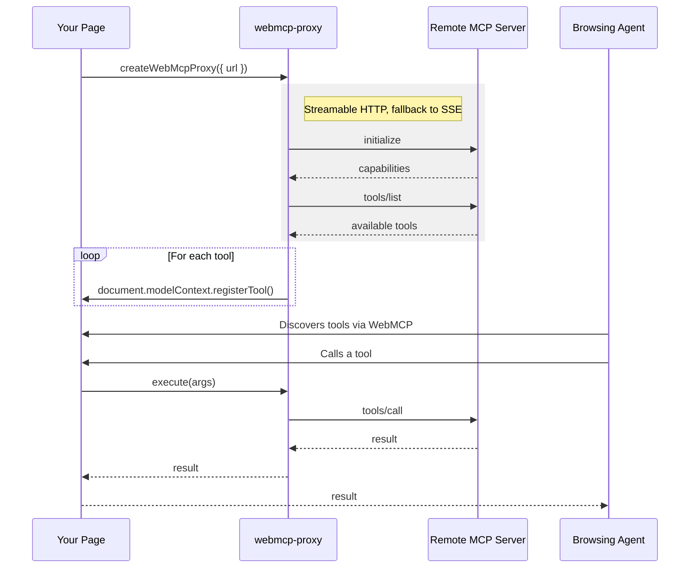

# WebMCP Proxy

Advertise your existing MCP server's tools via [WebMCP](https://github.com/webmachinelearning/webmcp) on your website so any browsing agent can use them.

WebMCP Proxy connects to a remote MCP server, discovers its tools, and registers them with the browser's `document.modelContext` API. When a browsing agent invokes a tool, the call is proxied to your MCP server and the result forwarded back.

When WebMCP is not available natively, the proxy automatically installs the official [`@w3c/webmcp-polyfill`](https://github.com/w3c-oss/webmcp-polyfill). No extra setup is needed, including with the React and Vue integrations. Existing native implementations (including the older `navigator.modelContext` API) are preserved.

## Installation

```bash
npm install webmcp-proxy
```

## Usage

### Vanilla JS

```typescript
import { createWebMcpProxy } from "webmcp-proxy";

const proxy = await createWebMcpProxy({
  url: "https://mcp.example.com/mcp",
});

console.log("Registered tools:", proxy.tools);

// Later, to clean up:
await proxy.disconnect();
```

### React

```tsx
import { WebMCPProxy } from "webmcp-proxy/react";

export default function App() {
  return (
    <>
      <WebMCPProxy url="https://mcp.example.com/mcp" />
      {/* Your app content */}
    </>
  );
}
```

### Vue

```vue
<script setup>
import { WebMCPProxy } from "webmcp-proxy/vue";
</script>

<template>
  <WebMCPProxy url="https://mcp.example.com/mcp" />
  <!-- Your app content -->
</template>
```

## Options

All variants accept the same core options:

| Option    | Type                     | Required | Description                                                       |
| --------- | ------------------------ | -------- | ----------------------------------------------------------------- |
| `url`     | `string`                 | Yes      | URL of the remote MCP server                                      |
| `headers` | `Record<string, string>` | No       | Additional headers sent with every request (e.g. `Authorization`) |

## How it works



Starting in Chrome 153, each tool's `execute` callback receives an `AbortSignal` as `execute(input, { signal })`. The proxy forwards that signal to the remote MCP `tools/call`, so cancelled agent/user executions abort the in-flight request instead of leaving work running.

## Coexistence with page-specific tools

WebMCP Proxy uses `registerTool` rather than `provideContext` to manage tools. This means it **will not** overwrite other tools the page registers on its own — as long as those also use `registerTool`. Proxy tools and page-local tools coexist safely side by side.

Tool unregistration is handled via `AbortSignal` (the recommended approach starting from Chrome 148). For backward compatibility with older browsers, `unregisterTool()` is also called when available. As of Chrome 153, unregistering a tool no longer cancels in-flight executions — cancellation goes through the per-execution `signal` instead.

Only successfully registered tools are returned in `proxy.tools` and removed on disconnect. If a tool has no description, its name is used to satisfy WebMCP's non-empty description requirement.

## Testing without native WebMCP

On HTTPS or localhost, the polyfill lets in-page agents and browser extensions discover and call registered tools:

```typescript
const tools = await document.modelContext.getTools();
const tool = tools.find((tool) => tool.name === "your-tool-name");
if (tool) {
  const result = await document.modelContext.executeTool(tool, { /* arguments */ });
  console.log(JSON.parse(result));
}
```

The polyfill enables registration, discovery, execution, and cancellation; integration with an actual browser agent still requires browser support. WebMCP is a Community Group draft, and its API may change.

## Demo

A live demo is hosted at **[webmcp.netlify.app](https://webmcp.netlify.app/)**.

The `demo/` folder contains a standalone React + Vite app that lets you enter an MCP server URL, connect to it, and see the tools it exposes — all registered via WebMCP in the browser.

To run the demo locally:

```bash
pnpm run demo
```

This starts the Vite dev server with a built-in CORS proxy so you can connect to any MCP server without cross-origin issues.

## Requirements

- The remote MCP server must support **Streamable HTTP** or **SSE** transport
- The MCP server must allow CORS requests from the browser origin
- Serve the page over **HTTPS or localhost** so the polyfill can install the [WebMCP API](https://github.com/webmachinelearning/webmcp). Native WebMCP is used when available, with a fallback to the deprecated `navigator.modelContext` for older browsers. Outside a supported browser context (including server-side rendering), the proxy logs a warning and becomes a no-op without contacting the MCP server.

## License

ISC
